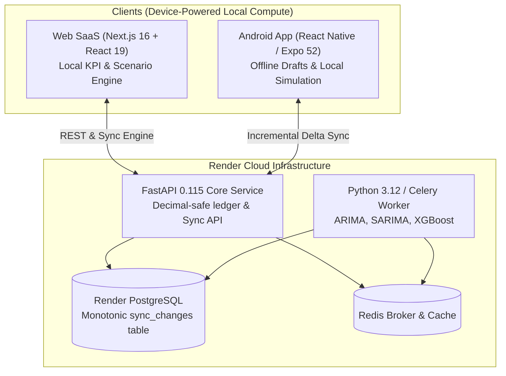

# FinSight AI – Intelligent Financial Management & Business Forecasting Ecosystem

[]()
[]()
[]()
[]()
[]()
[]()

FinSight AI is a production-grade financial command center and device-powered forecasting ecosystem designed for modern businesses, CFOs, treasury teams, and high-growth companies. 

It unites high-precision ledger accounting, multi-model AI forecasting, working capital ageing schedules, a What-If scenario sandbox, an offline-first Android mobile application, and central Render cloud synchronization with monotonic ordering guarantees.

---

## Key Pillars

### 1. Web Application & Commercial SaaS Experience
- **Commercial Landing Page**: Live forecasting demo, interactive scenario sandbox, business intelligence previews, security architecture breakdown, and pricing tiers.
- **Executive Command Center**: Ramp/Mercury/Linear design language with light and dark mode, responsive layout, and top-tier data hierarchy.
- **10 Interactive Financial Visualizations**:
  1. *Revenue vs. Expenses* (Composed monthly trajectory)
  2. *Net Cash Flow Trend* (Area & directional delta)
  3. *Daily Cash Balance* (Threshold alerts against configured minimum cash reserve)
  4. *Monthly Revenue* (Historical & projected variance)
  5. *Monthly Expenses* (Normalized cost structure)
  6. *Expense Category Breakdown* (Interactive Donut & concentration analysis)
  7. *Revenue Category Distribution* (Diversification tracking)
  8. *Cash Runway Projection* (Months of runway based on 90-day net burn)
  9. *Receivables vs. Payables* (Working capital liquidity comparison)
  10. *Historical vs. Forecasted Cash Flow* (Model uncertainty intervals)

### 2. Complete Transaction & Ledger Management
- **Decimal-Safe Monetary Arithmetic**: Zero floating-point rounding errors across all SQL queries and client calculations (`NUMERIC(16, 2)` / `Decimal`).
- **Inter-Account Transfers**: Dual-account booking (`account_id` and `to_account_id`) moves funds between bank/cash/card accounts without artificially distorting revenue or expense metrics.
- **Bulk Operations**: Bulk delete, bulk category assignment, and bulk status updates (`POST /api/transactions/bulk`).
- **Import / Export**: CSV and Excel statement imports with intelligent column auto-mapping, duplicate record suppression, and client CSV/Excel/PDF exports.

### 3. Accounts Receivable & Accounts Payable (AR / AP)
- **Ageing Schedules**: Real-time classification of open dues across 5 standard accounting buckets:
  - *Current (Not Due)*
  - *1 – 30 Days Overdue*
  - *31 – 60 Days Overdue*
  - *61 – 90 Days Overdue*
  - *> 90 Days Overdue*
- **Counterparty Summaries**: Customer dues and supplier obligations breakdown.
- **Partial Payment Accounting**: Real-time settlement with automatic general ledger transaction posting.
- **Printable Invoices**: Clean, exportable, print-ready formal invoice documents.

### 4. Advanced Financial Forecasting Engine
- **Multi-Model Tournament**: Evaluates Seasonal Naïve, Moving Averages, Simple Exponential Smoothing, Holt-Winters, `ARIMA(1,1,1)`, `SARIMA(1,1,1)(1,0,0,7)`, and Recursive XGBoost / Gradient Boosting.
- **Chronological Walk-Forward Validation**: Strict expanding-window holdouts with zero temporal leakage.
- **Evaluation Metrics**: Minimum out-of-sample **WAPE** (Weighted Absolute Percentage Error), MAE, and RMSE.
- **Descriptive Confidence Bands**: Dynamic prediction intervals derived from empirical validation residuals.
- **Cash Reserve Breach Detection**: Pinpoints the exact calendar date when projected cash is expected to breach operating reserves.

### 5. Device-Powered & Local-First Processing
- **Zero-Latency Computation**: Mobile devices and browsers calculate KPIs, category spending aggregations, What-If scenario simulations, and duplicate detection locally.
- **Offline Drafts**: Queue operations locally during flight mode or network drops and sync automatically upon reconnection.
- **Central Authority**: Centrally synchronized through Render PostgreSQL, preserving strict ledger consistency across all devices.

### 6. Android Mobile Application (`mobile/`)
- Native React Native / Expo application with bottom tab navigation:
  - `Home`: Executive liquidity overview and runway gauge.
  - `Activity`: Quick transaction management and offline draft entry.
  - `Analytics`: Category spending concentration and burn trajectory.
  - `Forecasts`: 30-day and 90-day time-series projections.
  - `More`: AR/AP Ageing, On-Device Scenario Sandbox, Cloud Sync, and Shareable Reports.

### 7. Cloud Synchronization Protocol (Render)
- **Monotonic Sequence Tokens**: Immutable, ascending `seq_num` assigned to every committed database change.
- **Idempotency Guarantee**: Unique `client_mutation_id` eliminates duplicate transaction postings.
- **Delta Sync**: Incremental sync pulls only changes occurring after the client's last acknowledged sequence token.

---

## Architecture Overview



---

## Quick Start: Running the Project

### 1. Run Web & API Stack (Local Docker Compose)
```bash
cp .env.example .env
docker compose up --build
```
- **Web Dashboard**: `http://localhost:3000`
- **FastAPI Backend**: `http://localhost:8000` (Swagger docs at `/docs`)
- **Demo Credentials**: `demo@finsight.ai` / `Demo1234!`

### 2. Run Backend Standalone (Python 3.12+)
```bash
cd backend
py -3.12 -m venv .venv
.\.venv\Scripts\Activate.ps1
pip install -r requirements.txt
uvicorn app.main:app --reload --port 8000
```

### 3. Run Web Standalone (Node 20+)
```bash
npm install
npm run dev
```

### 4. Run Android Mobile App (`mobile/`)
```bash
cd mobile
npm install
npx expo start
```
- Press `a` to open in your Android Emulator.
- Or scan QR code in **Expo Go** on your physical Android phone.

---

## Testing & Quality Assurance

### Run Backend Pytest Suite
```bash
py -3.12 -m pytest backend/tests
```
*Verification output: 27 of 27 unit, integration, and migration tests passing.*

### Run Frontend Vitest Suite
```bash
npm run test:ui
```
*Verification output: 9 of 9 unit and component tests passing.*

### Run Next.js Production Build
```bash
npm run build
```
*Verification output: Turbopack production compilation completed with 0 errors.*

---

## Documentation

- [System Architecture & Sync Protocol](docs/architecture.md)
- [Deployment & Render Operations](docs/deployment.md)
- [Forecasting Methodology & Validation](docs/forecasting.md)
- [Android Mobile App Guide](mobile/README.md)
