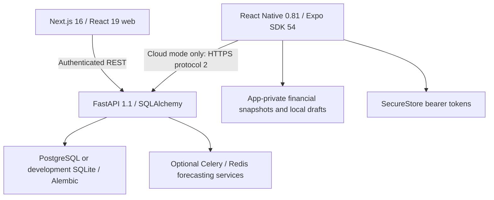

# Architecture and synchronization

## Financial and tenant boundaries

API reads/writes require authenticated business membership and are scoped by `business_id`. Roles are owner, admin, accountant, and viewer. The owner controls business settings; viewers do not write financial records. `DATABASE_SCHEMA` optionally isolates the application namespace in a shared PostgreSQL database; membership/business scoping provides tenant isolation.

Ledger amounts use database `NUMERIC(16, 2)` and Python Decimal; native monetary arithmetic uses safe integer minor units. Native inputs support two decimals and at most 12 whole-number digits. Same-currency, active, owned accounts are required. Transfers use `account_id` and `to_account_id`, moving account balances without changing consolidated operating cash, revenue, or expenses.

Consolidated operating cash is business opening cash + completed operating receipts − completed spending. Account opening balances are allocations, not another opening-cash contribution. Invoices are obligations until settled; a settlement reduces outstanding invoice balance and posts one ledger entry. Payment-linked entries and paid invoices have protected edit/delete semantics.

## Native workspace/storage architecture

`WorkspaceProvider` coordinates authentication/restoration, validated writes, materialized snapshots, role gating, and synchronization. Financial engines, reports, CSV previews, and scenarios operate on that snapshot.

- Local workspaces use UUID cache identities, negative draft IDs, and no cloud queue/upload.
- Cloud workspace cache identities include API address, user, and business, preventing cache reuse across accounts/servers.
- `finsight.v2.session`: non-token session metadata in AsyncStorage.
- `finsight.v2.token`: bearer token in SecureStore.
- `finsight.v2.local-session`: resumable local session metadata.
- `finsight.v2.workspace.${workspaceId}`: versioned snapshot, pending mutations, negative-ID allocator, and sync state.

Session/cache writes are serialized. Sign-out clears active UI state before credential removal; queued saves cannot resurrect credentials. Corrupt cache data is retained and rejected rather than silently replaced. Restoring a `finsight.backup.v1` snapshot creates a separate local workspace and clears cloud credentials.

## Sync protocol 2

Native cloud clients require API 1.1.0 or later implementing `protocol_version: 2`. Newly authenticated sessions are viewer/read-only until a pull confirms their permissions.

### `POST /api/sync/pull`

Accepts `{ "since_seq": N }` with the authenticated business header. Returns business metadata, role, protocol version, latest coherent tenant cursor, and either a baseline snapshot or ordered journal changes. `has_more`/`new_seq` support pagination. A cursor beyond the server's current state triggers a new baseline. Local queued overlays are reapplied over incoming authoritative records.

### `POST /api/sync/push`

Accepts a batch of mutations with `client_mutation_id`, entity/action, and financial input. Supports transactions, invoices, payments, accounts, and business settings with the same validation/permissions as REST writes.

A short tenant write lock serializes financial changes and cursor allocation (PostgreSQL row lock / SQLite writer lock). Each mutation uses a savepoint. The journal has unique business/sequence and business/mutation constraints. A canonical request hash and full stored acknowledgement make identical retries idempotent; reusing an ID for a different payload is a conflict. Rejected mutations do not poison later valid batch entries.

Acknowledgements remap negative IDs and dependent account/invoice references. Payment acknowledgements include payment, invoice, and ledger data. Pulled payment events do not independently post a duplicate receipt. Partial record updates preserve omitted fields.

### `GET /api/sync/status`

Reports the authenticated business's committed cursor/status.

Failures retain queued drafts with actionable notices. Write permission revocation still permits a permissions pull; an empty queue is not a connectivity check. Current synchronization runs sequentially while the app is active, on reconnect/foreground and once per minute. There is no timestamp-based Last-Write-Wins claim or OS background-sync service.

## Migrations and verification

Startup runs Alembic rather than unrestricted runtime schema alteration. `0003_mobile_sync` follows `f3dd8e733358`, adds durable acknowledgements/hashes, tenant cursor constraints/indexes, and transfer linkage, and adopts legacy unversioned journals while retaining events. Legacy application databases are stamped at the predecessor and upgraded.

Backend tests cover migrations, tenant/role protections, partial-batch rollback, pagination, concurrent writers, and exactly-once payment retries. Mobile tests cover financial semantics, actual React Native rendering, persistence/isolation, imports/exports, protocol compatibility, and conflict handling. APK verification separately exercises real Android modules and native files; see [the mobile guide](../mobile/README.md).
