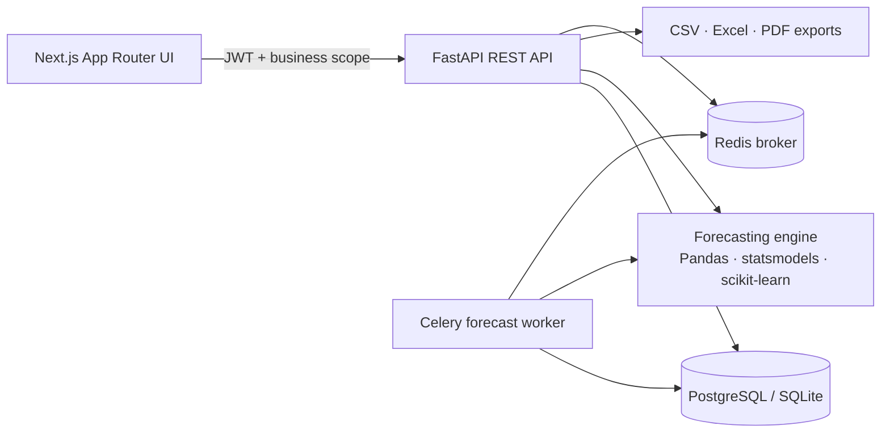

# FinSight AI architecture

## Boundaries

- A user can access a business only through a `business_members` membership. Each transaction query includes the authorized business id.
- Monetary inputs and stored values use Python `Decimal` and SQL `NUMERIC(16,2)`. Conversion to display numbers occurs at the API response boundary.
- Completed transactions power historical analytics. Pending and scheduled entries remain visible as open obligations and are applied on their due date in cash projections.
- Enabled recurring templates add future due dates. A scheduled transaction with matching date, type, amount, and category suppresses the duplicate recurring occurrence.
- The dashboard labels its cash flow / revenue ratio as net cash margin. It does not imply accrual profit margin without ledger data for recognition and matching.
- Revenue and expense forecasts are separate. Forecast candidates are selected using a chronological holdout; the baseline remains available when history is insufficient.
- Rule based insights report the evidence used and the action that follows from it. No LLM makes accounting decisions.

## Main services

- `backend/app/api.py`: authenticated routes, business scoping, imports, analytics, simulations, notifications, and exports.
- `backend/app/forecasting.py`: daily aggregation, feature creation, candidate evaluation, model selection, intervals, and limited-data baseline.
- `backend/app/seed.py`: repeatable 24 month synthetic demo business.
- `components/dashboard.tsx`: responsive dashboard and feature views backed by the API.
